# 雨课助手

Tampermonkey 用户脚本 + 原生桌面管理台。脚本负责在雨课堂页面内自动刷视频/音频、翻课件、AI 答题；桌面管理台（Go + Wails）负责启动本地服务、安装/更新脚本、配置 AI、查看日志，不用再记命令。

> 仅供学习交流，请遵守平台使用条款。见文末免责声明。

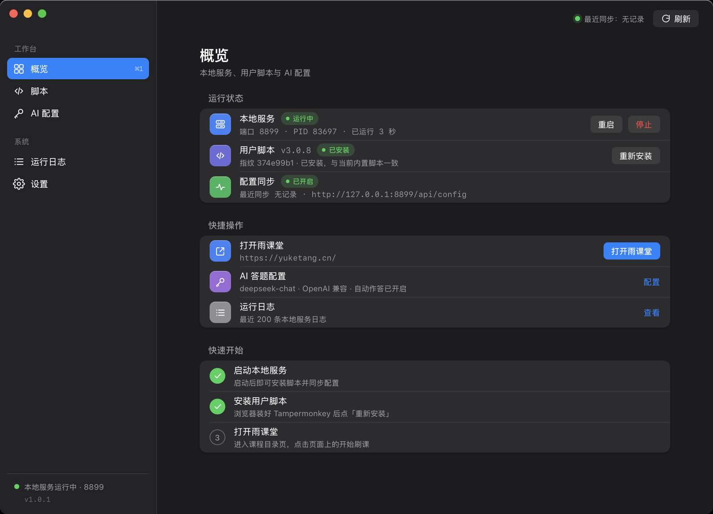

## 两种用法

### 方式一：桌面管理台（推荐）

原生窗口、跨 macOS / Windows / Linux（当前仅在 macOS 15 + Apple Silicon 实机验证）：

- 启动 / 停止本地服务，自动展示端口、PID、运行时长
- 在浏览器中安装 / 更新用户脚本（Tampermonkey 确认一次即可）
- 打开雨课堂、修改默认网址
- 在 App 内填写 AI API 地址 / Key / 模型 / 格式，打开雨课堂时脚本自动从本机同步
- 运行日志、脚本版本与指纹、安装状态一目了然
- 端口、外观（跟随系统 / 浅色 / 深色）、开机自启等设置
- 首次启动带分步新手教程：从装扩展、装脚本到开始刷课，按按钮走完即可，不需要写代码或开终端

界面设计语言与同一作者的「超星助手」桌面端统一（unslop 方法：中性灰 + 单一系统蓝强调、
系统设置式分组列表、彩色语义行图标、克制动效，不用渐变/发光/emoji/营销文案）。完整视觉规格见
[`docs/DESIGN.md`](docs/DESIGN.md)；两个 App 并排使用应像同一套产品的两个模块。

构建与运行：

```bash
# 需要 Go 1.26+、Wails v2 CLI（go install github.com/wailsapp/wails/v2/cmd/wails@latest）与 Xcode Command Line Tools
make app                 # 或 wails build
open build/bin/ykt.app   # macOS；Windows/Linux 产物在 build/bin/ 下
```

首次使用流程：打开 App → 点「安装 / 更新脚本」并在 Tampermonkey 弹窗中确认 → 点「打开雨课堂」登录 → 进入**课程目录**页（不是视频页）→ 点网页左下角面板的「开始刷课」。

### 方式二：命令行 `ykt`

保留给终端用户 / 服务器环境。纯 Go 编译，不依赖 Node：

```bash
make cli                 # 输出 bin/ykt
make install-cli         # 安装到 ~/.local/bin/ykt
```

| 命令 | 说明 |
| --- | --- |
| `ykt start` | 启动/复用本地服务，必要时打开脚本安装页，然后打开雨课堂 |
| `ykt install` | 只安装 / 更新用户脚本 |
| `ykt open [网址]` | 打开雨课堂；传入网址会记住为默认地址 |
| `ykt panel` | 打开本地控制台页面（查看版本/指纹，也可手动安装） |
| `ykt status` | 查看脚本版本、指纹、服务状态与安装记录 |
| `ykt serve` | 前台运行本地服务（调试用） |
| `ykt stop` | 停止本地服务 |
| `ykt restart` | 重启本地服务 |
| `ykt version` | 打印 App / 脚本版本与指纹 |
| `ykt help` | 查看全部命令与参数 |

入口差异：**纯 CLI 版** `ykt` 无参数等同 `ykt start`；**GUI 版**（`ykt.app`）无参数才打开窗口。脚本和终端里建议始终显式写子命令，避免歧义。

常用参数：`--port 8899`（可选 8899–8910，被占用自动顺延）、`--url <网址>`、`--force`（强制重装脚本）、`--no-open`（只准备服务，不调用浏览器）。

### 方式三：只用用户脚本

在 Tampermonkey 中新建脚本，粘贴 `yuketang.js` 内容即可（或运行 `ykt install` 从本地服务安装）。脚本本身零依赖，匹配 `*://*.yuketang.cn/*` 与 `*://*.gdufemooc.cn/*`。

## 配置同步（AI 答题 / 自动回复）

打开雨课堂页面时，脚本会尝试连接本机 `127.0.0.1:8899~8910` 的 ykt 本地服务，读取你在 App 里保存的 AI 配置与功能开关：

- 本地服务未启动、同步被关闭，或 App 里从未保存过配置时，脚本保留网页里「AI 配置」面板的设置，行为与旧版一致
- 在 App 里保存过配置后，以 App 设置为准（每打开一次雨课堂页面同步一次）
- API Key 只保存在本机 `~/.ykt/config.json`（权限 0600），不会上传到任何第三方

支持的 AI 服务商：DeepSeek、Kimi（Moonshot）、通义千问、OpenAI、Claude（Anthropic），也支持任何兼容 OpenAI / Anthropic 格式的地址。

## 自动更新

桌面 App 从本仓库的 GitHub Releases 检查更新（设置 → 更新）：

- 启动后静默检查一次；发现新版本会提示，在「设置 → 更新」里点「下载并重启」
- 下载后强制校验 Release 里的 `checksums.txt`（SHA256），校验 App 标识与版本号后才替换
- 替换由脱离的辅助脚本在本 App 退出后完成，失败自动回滚；更新日志在 `~/.ykt/update.log`
- 仅支持从 `/Applications` 或 `~/Applications` 运行的正式包；仓库里的开发构建不会自替换

发布新版本（维护者）：

```bash
# 本地打包检查（产物在 dist/release/）
VERSION=1.1.0 bash tools/package-release.sh
# 打标签推送，GitHub Actions 会自动构建并发布 Release（资产命名见 .github/workflows/release.yml）
git tag v1.1.0 && git push origin v1.1.0
```

已知限制：App 未签名/未公证，首次分发仍可能被 Gatekeeper 拦截（右键打开）；自动更新只校验 SHA256 与 GitHub TLS，不提供 Sparkle 级签名链；Windows/Linux 的桌面 App 暂未纳入自动发布，CLI 用户可继续 `make cross-cli` 或下载 Release 资产。

## 新手教程（零基础）

第一次打开 App 会自动弹出分步引导，文案只讲「点哪里、会发生什么」，不需要懂代码：

1. 装好浏览器扩展 Tampermonkey（已装可跳过）
2. 点「安装 / 更新脚本」，在浏览器弹窗里确认安装
3. 点「打开雨课堂」，登录后进入**课程目录**页
4. 在网页左下角面板点「开始刷课」

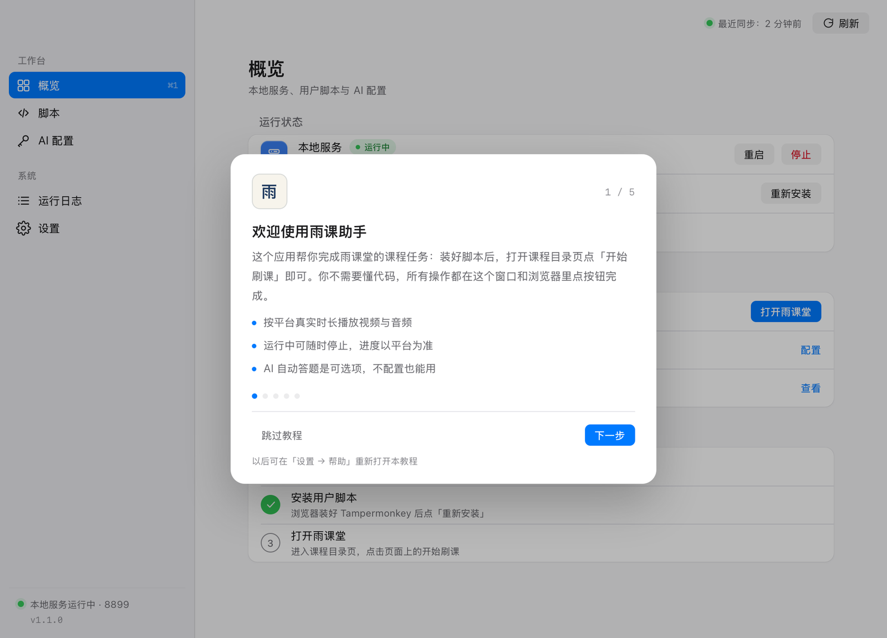

之后想再看：设置 → 帮助 → 新手教程；跳过教程也算完成，不会重复打扰。

## 界面预览

| 概览（浅色） | 概览（深色） |
| --- | --- |
| 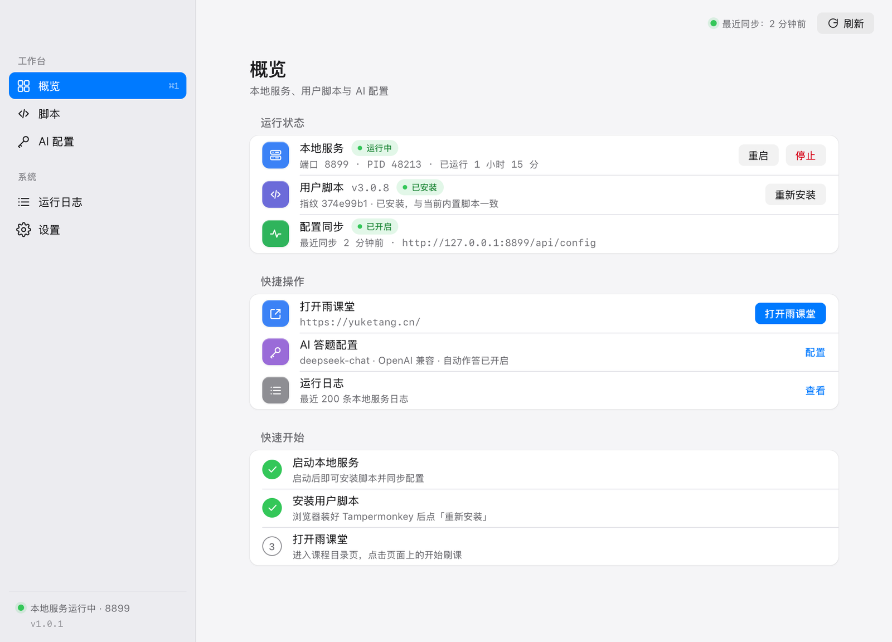 | 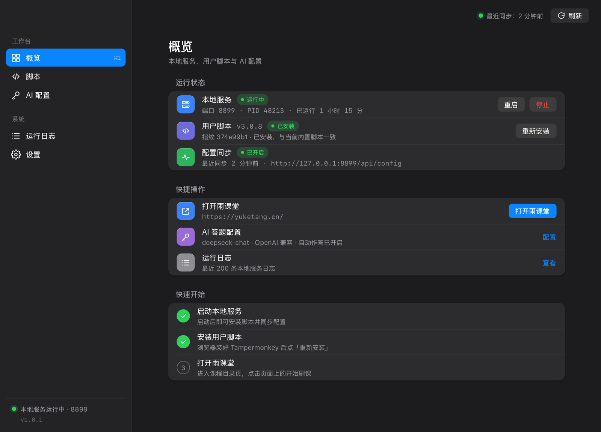 |

| AI 配置 | 运行日志（深色日志仪表） |
| --- | --- |
| 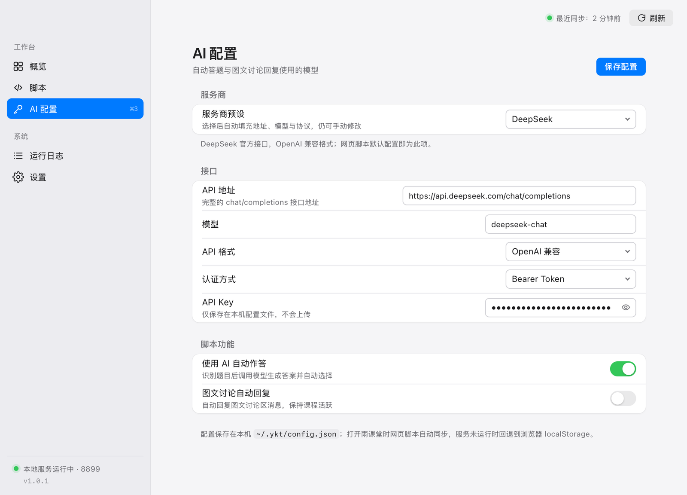 | 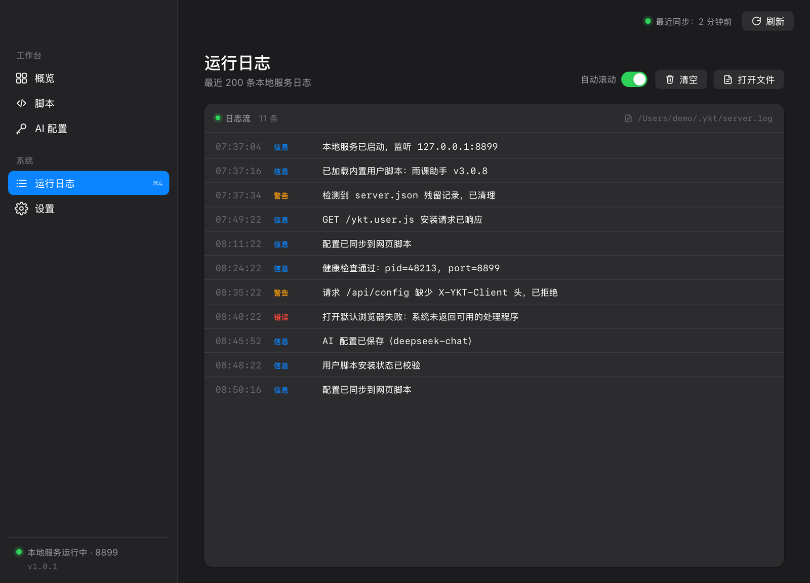 |

| 设置（含软件更新） | 真实窗口（浅色） |
| --- | --- |
| 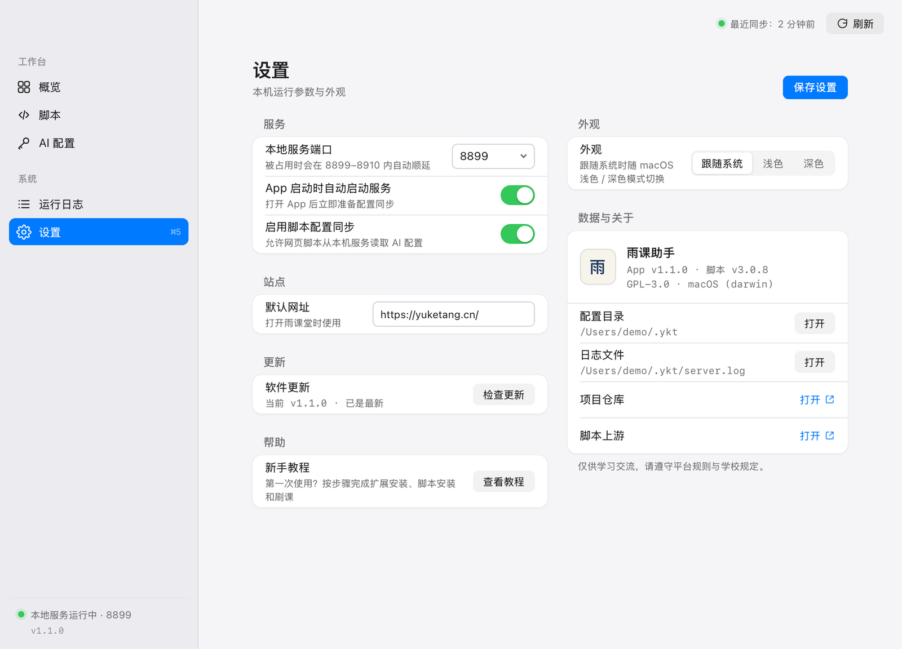 | 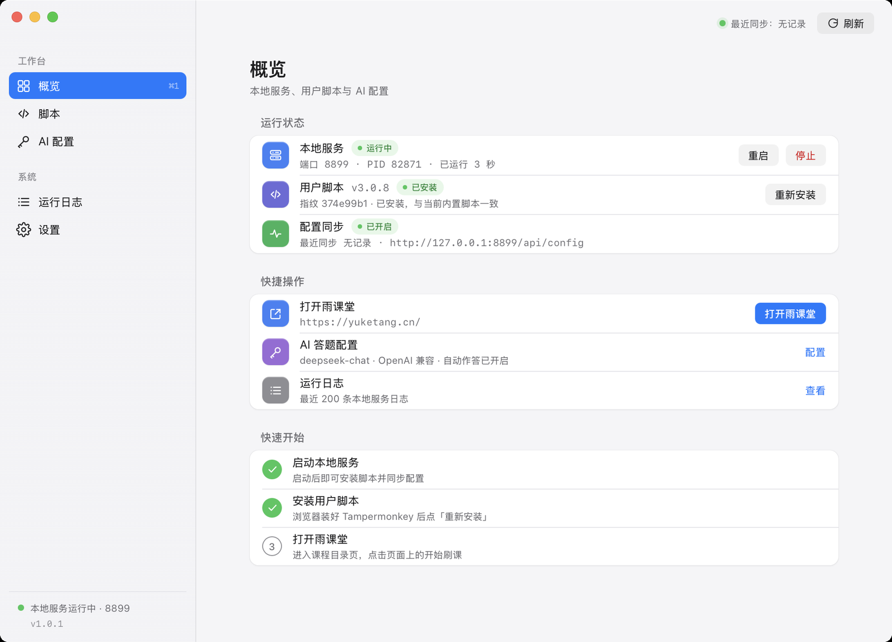 |

| 网页内注入面板（浅色） | 网页内注入面板（深色） |
| --- | --- |
| 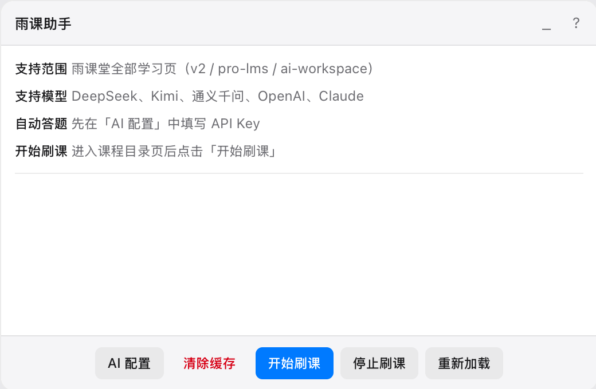 | 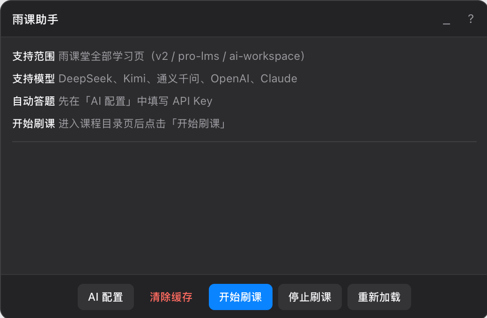 |

| 新手引导（浅色） | 新手引导（深色） |
| --- | --- |
|  | 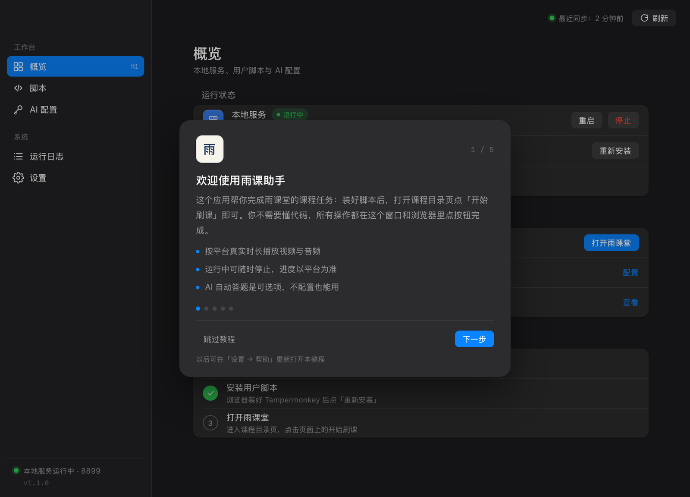 |

## 已适配雨课堂学校及网址

学校：中原工学院，河南大学研究院，广东财经大学，辽宁大学，河北大学，中南大学，电子科技大学，华北电力大学，上海理工大学研究生院、东南大学研究生院及其他院校...

网址：changjiang.yuketang.cn，yuketang.cn ...

## 开发

```
├── main_gui.go / app.go     # Wails 桌面 App 入口与前端绑定（-tags !cli）
├── main_cli.go              # 纯 Go CLI 入口（-tags cli，纯 Go、不依赖 cgo）
├── internal/                # config / script / server / browser / cli
├── frontend/                # 原生 HTML/CSS/JS 界面（无 npm、无 CDN）
├── yuketang.js              # 用户脚本（编译时内置进二进制）
├── docs/CONTRACT.md         # 内部接口契约
└── Makefile
```

```bash
make test       # Go 单元测试 + App 集成测试（macOS 需 CGO_LDFLAGS，Makefile 已处理）
make vet        # 静态检查（internal / 纯 CLI / GUI 三种构建）
make cross-cli  # 交叉编译 macOS / Linux / Windows CLI 到 dist/
bash tests/smoke.sh           # 端到端冒烟（76 项：CLI、HTTP、配置同步、进程生命周期）
node tests/appsync_probe.mjs  # 网页脚本 AppSync 隔离探针（15 项）
```

质量现状（2026-11-04）：Go 单元/集成测试 126 + 5 项全绿（含 `-race`）；CLI 冒烟 76/76；
AppSync 探针 15/15；独立 QA 审计报告见 [`docs/qa-report.md`](docs/qa-report.md)
（0 严重、0 中危遗留，仅 2 项低危后续优化：日志轮转、历史遗留 `.gitingore` 文件）。

依赖与数据位置：`~/.ykt/`（`config.json` 设置与 AI 配置、`state.json` 安装记录、`server.json` 服务信息、`server.log` 日志）。

## 常见问题

- **浏览器没有弹出脚本安装确认？** 确认已安装 Tampermonkey，并允许浏览器打开本地地址 `127.0.0.1`；可运行 `ykt install` 重试。
- **面板没有出现？** 确认当前是课程目录 / 学习页（`/v2/web/*`、`/pro/lms/*`、`/ai-workspace/lms-graph/*`），刷新页面再试。
- **AI 答题不生效？** 先在 App 的「AI 配置」里填好 Key 并保存，再打开雨课堂；面板里出现「已从本机 App 同步配置」即生效。
- **端口 8899 被占用？** App 会自动在 8899–8910 内顺延；如需固定，可在设置里选择端口。
- **macOS 提示「无法验证开发者」？** 当前构建未做 Apple 公证，右键 App → 打开，或执行 `xattr -dr com.apple.quarantine build/bin/ykt.app`。

## 脚本来历

油猴上有好多刷课脚本，不过我试了好几个点赞量很多的脚本却均在雨课堂上并不生效，很佩服这些大佬写上千行代码实现各平台的刷课脚本，也被吓到过，不过自己最终还是实现了雨课堂专用脚本，脚本内容简洁详细，仅100余行（初代），且有一定的代码备注，想学习的同学可以容易查阅。不过，写脚本倒是锻炼自己dom,bom的好机会。学习了很多。
进一步更新优化了代码结构，不过里面的代码还是很丑，欢迎大家pull。

欢迎大家补充 star：[github 地址](https://github.com/Niuwh/yuketang-jiaoben)

## 温馨提示

好好学习，天天向上，适当刷课，快乐成长^_^

## 免责声明

用户脚本（Userscript）是一种程序，通常用 JavaScript 编写，可用于修改网页代码以增强用户的浏览体验。具体用途有添加网页的快捷按钮，控制视频播放速度以及为网站添加其他功能。在 Firefox 浏览器等桌面浏览器上，Userscripts 是通过浏览器扩充功能中的脚本管理器（例如 Greasemonkey）启用的。

此项目作为开源的用户脚本，遵循用户脚本的编写规范，并且使用纯粹的 JavaScript 执行代码，不对页面进行任何源码的修改，不附加任何非法入侵计算机系统的功能，不对客户端计算机进行任何破坏越权控制等行为。

该项目作为开源用户脚本，供各大用户学习、交流、参考、使用，项目所有功能均为开源免费。使用本项目即代表用户对此项目的源码和功能有一定的了解，对于所造成的一切后果均由用户自己承担。

## 脚本作者承诺

如脚本无意冒犯了您的著作权，请联系作者进行删除，绝不再进行此类活动侵犯您的权益。

## 贡献者名单

- duck123ducker：解决了雨课堂进入后台意外暂停的 bug
- insorker：增加错误页面匹配提醒 && 修改倍速函数，支持 3 倍速
- PRO-2684：解决了 pro/lms 路线雨课堂切屏检测问题
- pioneerRick：增加了批量中图文和讨论的自动回复功能，以及使用 OCR 识别作业后利用大模型生成回复自动回答功能
- 语冰：修复了 panel 无法插入的问题
- ANGJustinl：添加 AI 伴学弹出窗口路由支持
- tfia：增加了对 Anthropic 格式 API 和相应认证方式的支持，并增加选项供用户选择
- xinyangcui：修复了面板增加停止刷课 bug、添加重新加载按钮

如有任何问题或提议，欢迎大家访问我的网站：[https://niuwh.cn](https://niuwh.cn)，里面有我的联系方式。或者博客留言：[https://blog.niuwh.cn](https://blog.niuwh.cn)。
